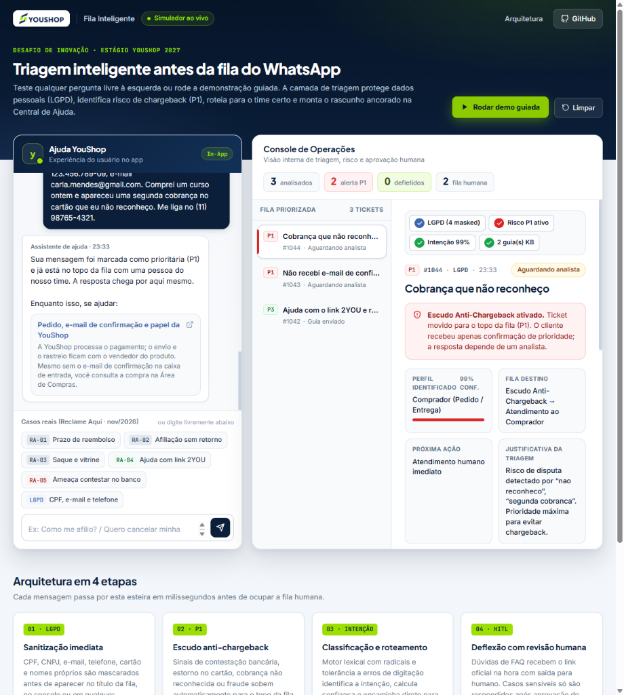

<p align="left">
  
</p>

# Fila Inteligente YouShop — Triador Operacional & Escudo Anti-Chargeback

Protótipo funcional desenvolvido para o **Desafio de Inovação — Programa de Estágio YouShop 2027 (Operações · Automação e IA)**.

🔗 **[Acessar protótipo interativo ao vivo](https://jcminozzi.github.io/fila-inteligente-youshop/)** *(clique em **Rodar demo guiada** no topo para ver os 3 cenários em sequência, ou digite qualquer dúvida livre)*

---

## Prévia do protótipo ao vivo



> À esquerda, o canal de ajuda dentro do app; à direita, o console interno de Operações com sanitização LGPD, alerta **P1 Anti-Chargeback**, roteamento de fila e rascunho assistido com aprovação humana obrigatória (**Human-in-the-Loop**).

---

## O problema observado

Hoje, quem precisa de ajuda no app YouShop Creators (comprador, creator ou produtor) sai para a Central de Ajuda no navegador ou cai na fila geral do WhatsApp sem triagem prévia. Com isso, dúvidas simples já documentadas (*"como criar meu link 2YOU?"*) disputam a mesma fila que casos críticos (*"se não responderem vou contestar no banco"*).

Na amostra das **5 reclamações públicas mais recentes da YouShop no Reclame Aqui (nov/2026)**, todas foram resolvidas com **notas 9 e 10** — mostrando que o atendimento humano é excelente, mas o gargalo está na espera inicial.

---

## O que o protótipo executa (em 4 etapas)

| Etapa | O que faz na prática |
|---|---|
| **01 · Sanitização LGPD** | Mascara CPF, CNPJ, e-mail, telefone, cartão e nomes próprios **antes** de exibir na fila, no console ou enviar para qualquer LLM. |
| **02 · Escudo Anti-Chargeback (P1)** | Detecta sinais de contestação bancária, estorno no cartão, cobrança não reconhecida ou fraude e eleva o ticket para o topo da fila humana sem resposta automática. |
| **03 · Classificação & Roteamento** | Motor lexical em PT-BR (radicais + tolerância a erros de digitação) identifica perfil e confiança, direcionando para **Operações (KYC)**, **Comercial (Vitrine)**, **Onboarding** ou **Atendimento ao Comprador**. |
| **04 · Deflexão FAQ & Human-in-the-Loop** | Dúvidas documentadas recebem o guia oficial de `ajuda.youshop.co` ou `customer.youshop.com.br` na hora (com saída para humano em 1 clique). Casos sensíveis só são enviados após aprovação do analista. |

**Governança explícita:** a automação nunca aprova saques, não valida KYC e não executa ações financeiras sozinha.

---

## Estrutura do repositório

| Arquivo | Descrição |
|---|---|
| [`index.html`](index.html) | Protótipo web interativo completo (canal do cliente + console de Operações + demo guiada). Arquivo único, zero dependências. |
| [`triador_youshop.py`](triador_youshop.py) | Script Python executável em lote sobre os 5 casos reais anonimizados; gera `triagem_resultado.json` e painel HTML, com suporte opcional à API do Gemini sobre texto já anonimizado. |
| [`assets/`](assets/) | Logo oficial utilizado na demonstração e capturas de tela do protótipo. |

---

## Como executar localmente

**Web:** basta abrir [`index.html`](index.html) no navegador ou acessar diretamente **[jcminozzi.github.io/fila-inteligente-youshop](https://jcminozzi.github.io/fila-inteligente-youshop/)**.

**Python (3.9+, apenas biblioteca padrão):**
```bash
# Processa os 5 casos reais anonimizados e gera JSON + painel HTML
python triador_youshop.py

# Modo interativo para testar qualquer mensagem ao vivo no terminal
python triador_youshop.py --interativo
```

*(Opcional)* Para testar o refinamento de redação com LLM sobre o texto já sanitizado pela camada LGPD:
```powershell
$env:GEMINI_API_KEY="sua_chave_aqui"
python triador_youshop.py
```

---

## Transparência metodológica

Não possuo acesso aos sistemas internos da YouShop para afirmar quais regras de triagem já existem nos bastidores. Todo o diagnóstico foi ancorado em evidências públicas e observáveis na ponta: teste prático do app **YouShop Creators**, mapeamento da Central de Ajuda (`ajuda.youshop.co`) e amostra das 5 reclamações públicas recentes (anonimizadas).

## Autor

**João Carlos Minozzi** — Graduando em Ciência da Computação (UNI ÍTALO), experiência em Suporte Técnico de TI (atendimento em fila e SLA) e certificação ISO/IEC 27001 em Segurança da Informação.

*Projeto independente para o Desafio de Inovação YouShop 2027, sem vínculo oficial com a empresa.*
